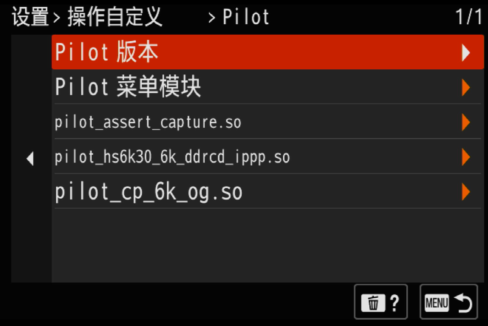
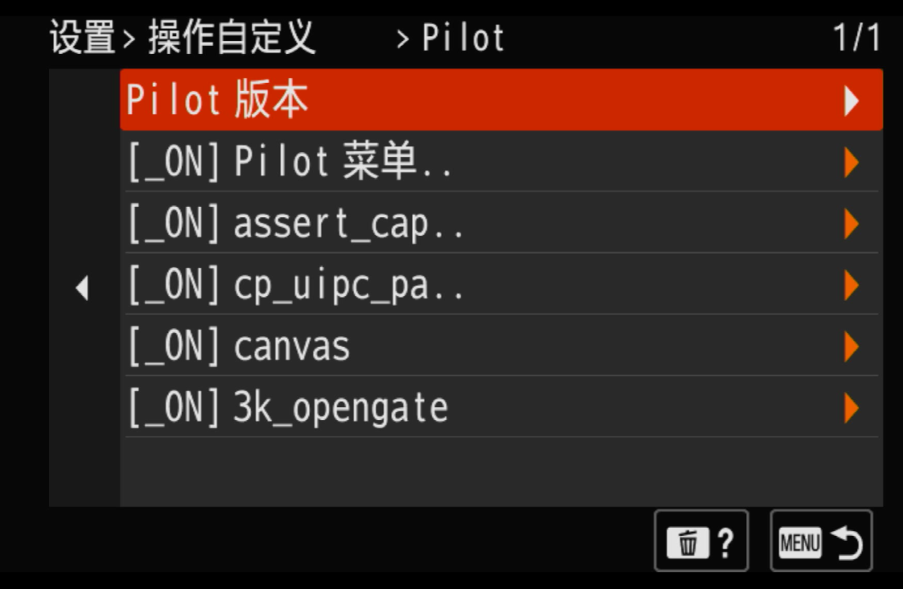
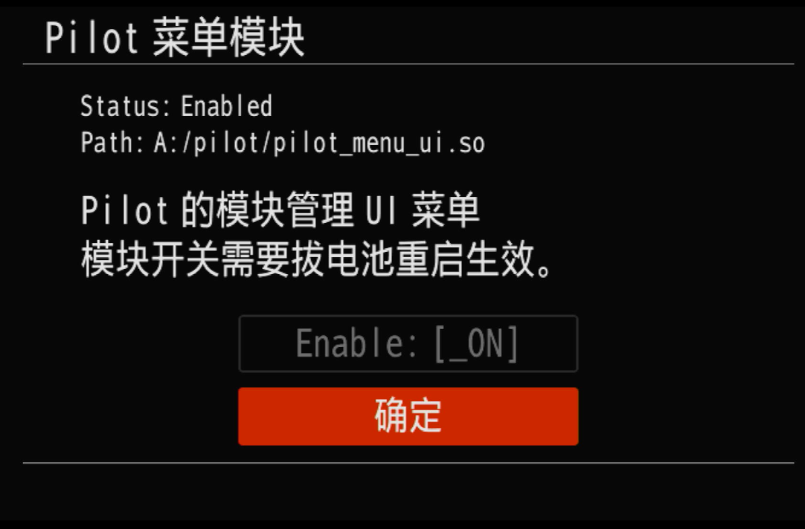
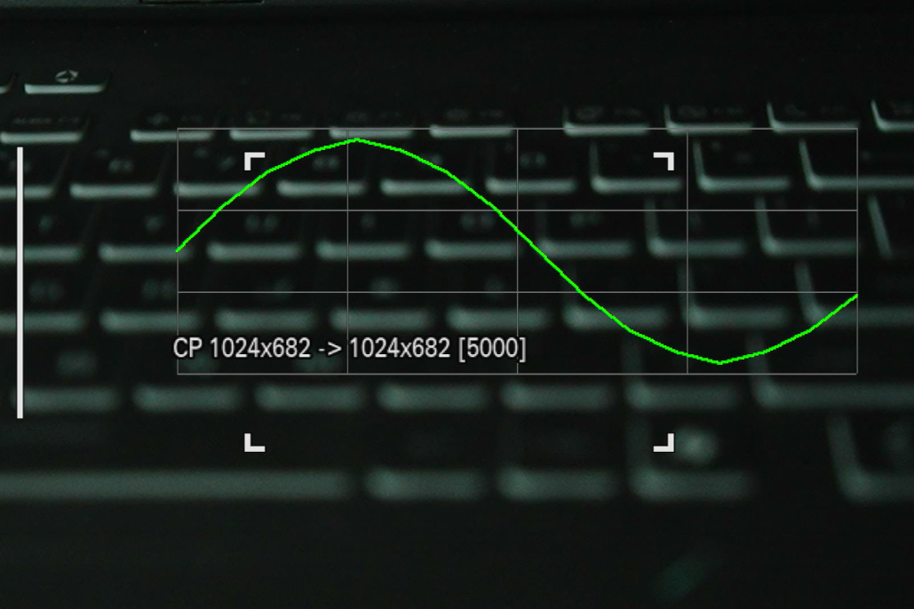

# Pilot

Pilot 是索尼相机的模块化扩展框架，支持运行时访问 AP / CP 内存、写入代码区，并从 SD 卡加载功能模块。

<table>
  <tr>
    <td width="50%"></td>
    <td width="50%"></td>
  </tr>
</table>

<table>
  <tr>
    <td width="33%"></td>
    <td width="33%"></td>
    <td width="33%"></td>
  </tr>
</table>

## Features

- **运行时读写**：读取和修改 AP / CP 内存及代码区，CP 写入支持异步操作和 UIPC v4 批量处理。
- **模块加载**：通过 SD 卡清单选择和组合模块，框架负责加载与初始化。
- **文件与日志**：支持 SD 卡文件读写，以及框架和模块的独立日志。

## Develop

模块只需实现 `pilot_module_init`，即可通过 `PilotApi` 使用文件、日志、时间和内存等能力。`sdk/pilot_mod_util.h` 提供常用辅助函数；通用工具支持补丁描述、模块构建、部署和日志导出。

- [安装与使用](docs/USAGE.md)
- [模块开发与构建](docs/DEVELOPMENT.md)
- [通用补丁工具](tools/README.md)
- [下载模块和框架](https://github.com/Himpq/Pilot/releases)
