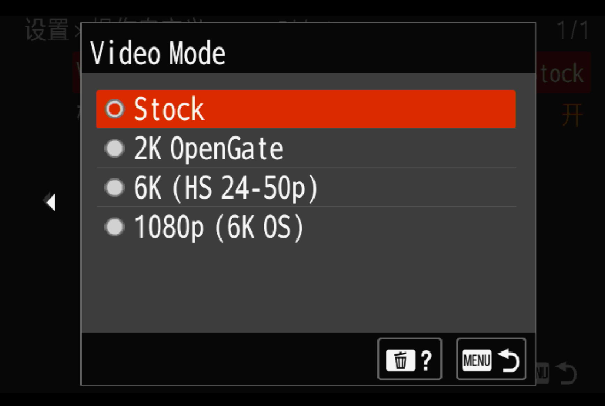

# Pilot

English · [中文](README.zh-CN.md)

Pilot is a modular extension framework for Sony cameras. It supports runtime access to AP / CP memory, writing to code regions, and loading feature modules from the SD card.

<table>
  <tr>
    <td width="50%"></td>
    <td width="50%"></td>
  </tr>
  <tr>
    <td width="50%"></td>
    <td width="50%"></td>
  </tr>
</table>

## Features

- **Runtime read/write**: read and modify AP / CP memory and code regions; CP writes support async operations and UIPC v4 batching.
- **Module loading**: select and combine modules through an SD-card manifest; the framework handles loading and initialization.
- **Files & logging**: SD-card file I/O, plus separate logs for the framework and each module.

## Discussion
Feel free to open an issue to report bugs, suggest new ideas, or even share your success stories!

## Develop

A module only needs to implement `pilot_module_init` to use files, logging, time, memory, and other capabilities through `PilotApi`. `sdk/pilot_mod_util.h` provides common helper functions; the general-purpose tooling covers patch descriptions, module builds, deployment, and log export.

- [Installation & usage](docs/USAGE.md)
- [Module development & builds](docs/DEVELOPMENT.md) (中文)
- [General patch tools](tools/README.md) (中文)
- [Download modules & framework](https://github.com/Himpq/Pilot/releases)
