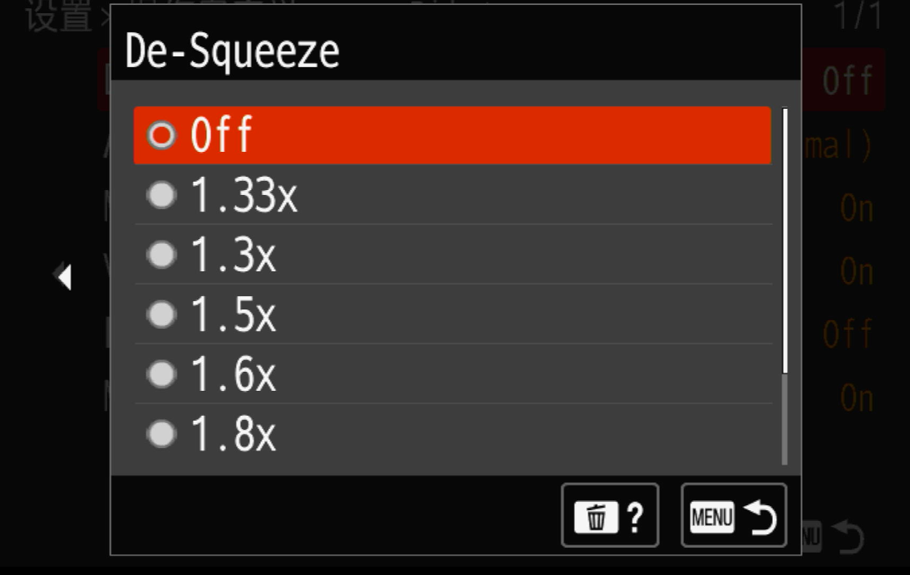
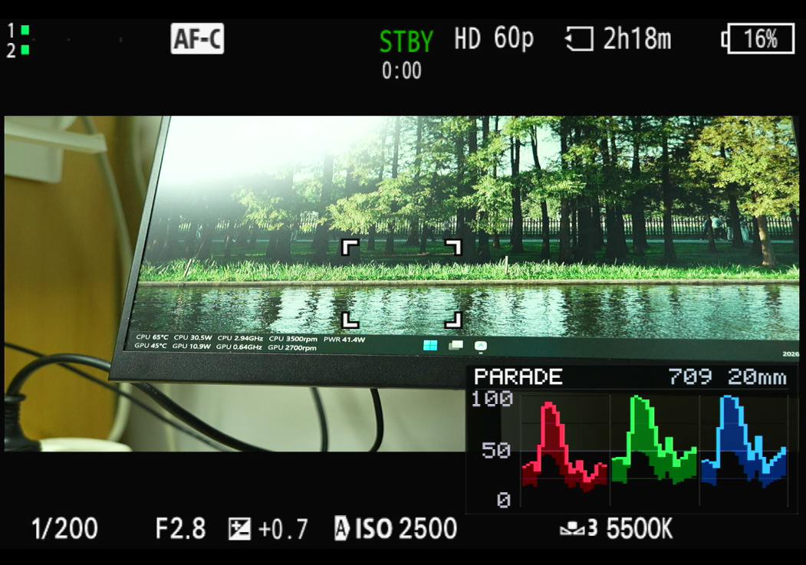

# `pilot_desqueeze.so`（ILCE-6700 FW 2.00 全倍率 & OpenGate 硬件反挤压模块）

独立 Pilot 扩展模块，激活并扩展 A6700 CP 固件中预置的 Sony FX3/FX30 硬件 VDF 反挤压管线，支持 **7 档主流变形镜倍率 × 双画幅基准（16:9 常规 / 3:2 OpenGate）** 及 LCD / EVF / HDMI 独立开关。

<table>
  <tr>
    <td width="50%"></td>
    <td width="50%"></td>
  </tr>
</table>

## 菜单项

通过 `pilot_menu_ui.so` 注册，配置持久化到模块目录 `config.txt`：

- `反挤压倍率`：`关闭` / `1.33x` / `1.3x` / `1.5x` / `1.6x` / `1.8x` / `2.0x (裁幅)` / `2.0x (全宽)`（默认关闭）
- `画幅基准`：`16:9 (常规)` / `3:2 (OpenGate)`（默认 `16:9`）
- `屏幕 (LCD)`：开 / 关（默认开）
- `取景器 (EVF)`：开 / 关（默认开）
- `外接 (HDMI)`：开 / 关（默认关）

## 倍率与像素矩形对照（已通过 Unicorn 仿真断言）

| 倍率 | 16:9 基准（`num/den` / LCD / EVF） | 3:2 OpenGate 基准（`num/den` / LCD / EVF） |
|---|---|---|
| `1.33x` | `27/64` (2.37:1) · `720×304` · `1024×432` | `1/2` (2.00:1) · `720×360` · `1024×512` |
| `1.3x` | `45/104` (2.31:1) · `720×312` · `1024×444` | `20/39` (1.95:1) · `720×368` · `1024×524` |
| `1.5x` | `3/8` (2.67:1) · `720×272` · `1024×384` | `4/9` (2.25:1) · `720×320` · `1024×456` |
| `1.6x` | `45/128` (2.84:1) · `720×252` · `1024×360` | `5/12` (2.40:1) · `720×300` · `1024×428` |
| `1.8x` | `5/16` (3.20:1) · `720×224` · `1024×320` | `10/27` (2.70:1) · `720×268` · `1024×380` |
| `2.0x (裁幅)` | `mode=2, 3/8` (2.67:1, 4:3 裁幅 1440×1080) · `720×272` · `1024×384` | `mode=2, 3/8` (2.67:1, 4:3 裁幅 1708×1280，保留 89% 宽) · `720×272` · `1024×384` |
| `2.0x (全宽)` | `9/32` (3.56:1, 不裁边) · `720×204` · `1024×288` | `1/3` (3.00:1, 不裁边) · `720×240` · `1024×340` |

## 工程保护机制

- **全模式照片保护**：`0x006BA3B0`（20B）把 `aspect == 2 || aspect == 5` 判断提前至 `mode 2` / `mode 1` 之前，`0x006BA3CA`（16B）尾调原厂 `0x001F6170`，无论是 `mode 1` 还是 `2.0x (裁幅)`（`mode 2`），切到照片模式（3:2 / 4:3 / 1:1）在 LCD/EVF/HDMI 均保持 100% 原厂比例。
- **任意倍率热切换**：5 处动态常数位点（`0x6BA3E8` / `0x1F659A` / `0x1F662E` / `0x6BA3E0` / `0x1F6586`）采用操作码骨架校验，可直接在不同倍率或 `16:9 ↔ 3:2 OpenGate` 之间一步热切换，无需先回 `关闭`。
- **与 `pilot_video_modes.so` 共存**：关闭前检查 `0x00E99E68`，不破坏正在运行的 2K OpenGate 的对焦框放行；250ms Watchdog 自动恢复休眠唤醒重置。

## 构建与验证

```sh
python modules/desqueeze/verify_desqueeze.py --cp /path/to/cpapp-b.bin --appfw /path/to/lib_appFw.so
bash modules/desqueeze/build.sh
```
