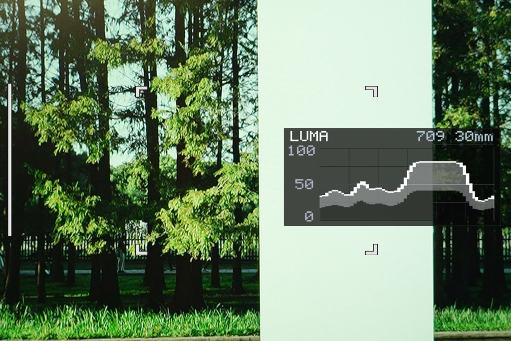
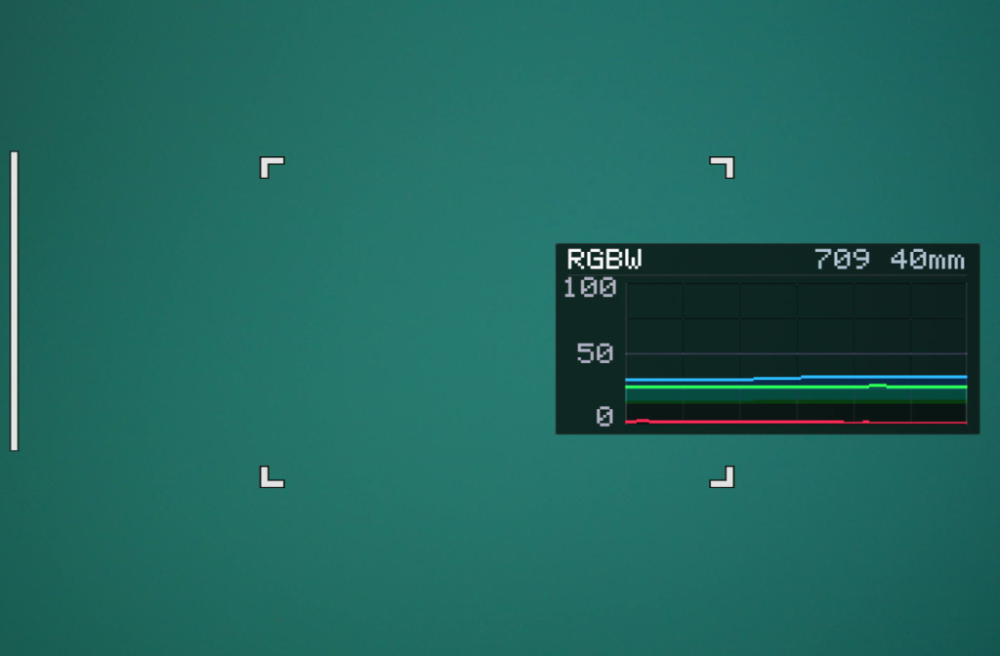

# Pilot Canvas & Live Waveform

为 ILCE-6700（固件 2.00）提供 Live View 原生画布绘制引擎与实时波形图/示波器悬浮组件，模块文件为 `pilot_canvas.so`。

<table>
  <tr>
    <td width="50%"></td>
    <td width="50%"></td>
  </tr>
</table>

## 功能

- **实时波形图与直方图**：直接读取 CP RAM 12-bit 线性 OPD 测光网格与实时白平衡增益，在取景器（LCD / EVF）中以 10 Hz 渲染 5 种视图：
  - **RGB Parade**：R / G / B 三通道并排波形
  - **White Wave (LUMA)**：亮度波形与高亮峰值包络
  - **RGB Wave (RGBW)**：R / G / B 叠加波形
  - **RGB Hist**：0–100 IRE 三色叠加直方图
  - **Off**：隐藏示波器
- **色彩与校准**：支持 **Rec.709** / **S-Log3** 伽马曲线切换与 **WB Calib**（实时白平衡增益校准），顶栏同步显示当前曲线与镜头焦距。
- **触摸与按键交互**：
  - 点击面板循环切换波形模式；
  - 长按拖拽自由调整面板位置，自动保存至 `/pilot/modules/pilot_canvas/layout.cfg`；
  - 按相机 `DISP` 键可在“无信息”页面后切入/切出 Pilot 虚拟显示页。
- **通用绘图与多文本服务（供其他模块调用）**：通过 [`pilot_canvas.h`](pilot_canvas.h) 导出基于原生 `ux::gfxeng::Sprite` 的批量矩形、折线、网格、5×7 OSD 字体绘制接口，以及互不覆盖的多槽位 `MultiLineTextSprite` 文本接口（`pilot_canvas_text_set`）。

> **说明**：伪色（False Color）目前为实验性功能，尚在验证中，暂未在本版本作为稳定特性启用。

## 依赖

- [Pilot v0.2.0](https://github.com/Himpq/Pilot/releases/tag/v0.2.0)（A6700）
- [MenuUI v0.2.0](https://github.com/Himpq/Pilot/releases/tag/menu-ui-v0.2.0)（需排在 `pilot_canvas.so` 之前加载，用于提供 Live View 宿主挂接与 Pilot 菜单设置项）

## 安装

1. 将 `pilot_canvas.so` 复制到 SD 卡 `/pilot/`。
2. 在 `/pilot/modules.json` 中启用 `pilot_menu_ui.so` 与 `pilot_canvas.so`（`pilot_menu_ui.so` 需排在前面，可参考 [`modules.example.json`](modules.example.json)）。
3. 装卡并完整断电重启相机。

## 使用

1. 在 Live View 界面按 `DISP` 切到波形图页面，或点击/拖拽面板直接切换模式与调整位置。
2. 打开 **设置 → 操作自定义 → Pilot → pilot_canvas.so**，可配置：
   - **Scope Mode**：`RGB Parade` / `White Wave` / `RGB Wave` / `RGB Hist` / `Off`
   - **Gamma Curve**：`Rec.709` / `S-Log3`
   - **WB Calib**：`Off` / `Auto`
3. 模块日志位于 `/pilot/modules/pilot_canvas/module.log`（或 `/pilot/log.txt`）。

## 停用

在 Pilot 菜单中将 **Scope Mode** 设为 `Off`，或从 `/pilot/modules.json` 中移除 `pilot_canvas.so` 后完整断电重启。
